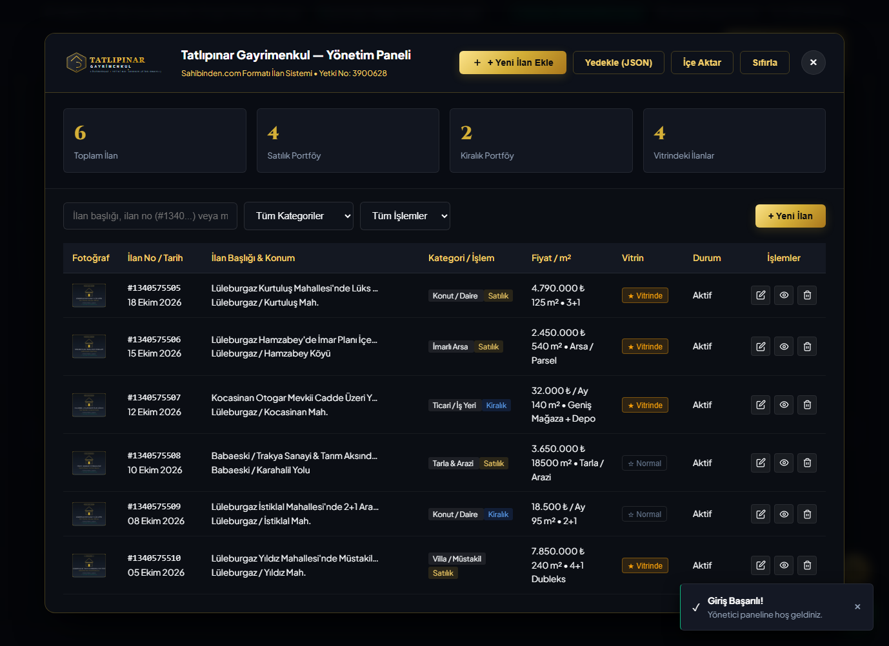
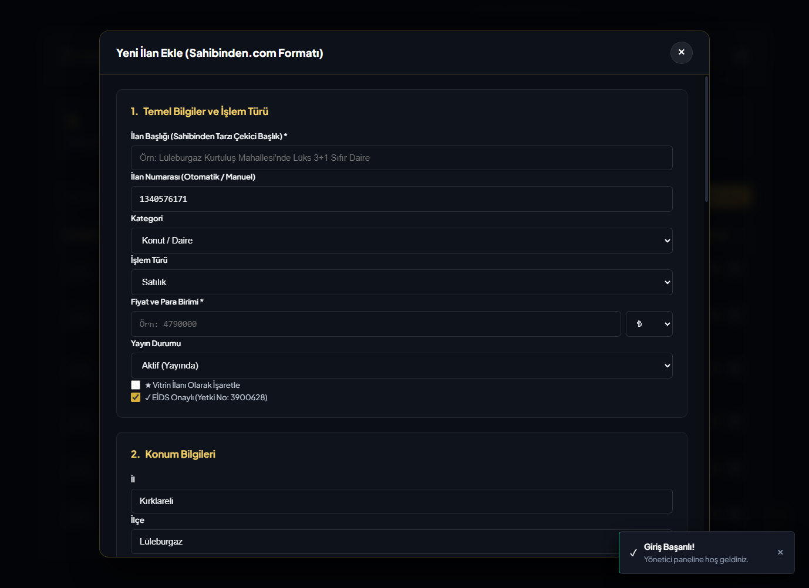
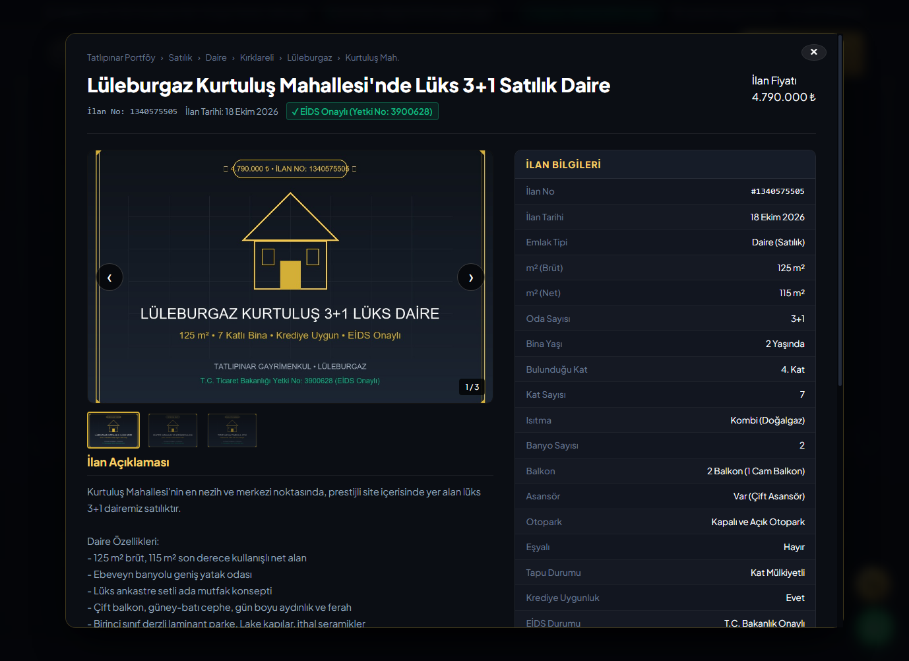

# Tatlıpınar Gayrimenkul — Kurumsal Web Sitesi & Yönetici Paneli

Lüleburgaz / Kırklareli merkezli **Tatlıpınar Gayrimenkul** için modern, lüks siyah & altın temalı, mobil uyumlu, SEO odaklı ve **Sahibinden.com formatında dinamik yönetici paneline** sahip kurumsal gayrimenkul web platformu.

> **T.C. Ticaret Bakanlığı Taşınmaz Ticareti Yetki Belgesi No:** `3900628` (EİDS Onaylı)  
> **Broker / Kurucu:** Orkun Tatlıpınar  
> **Adres:** Otogar Mevkii, Kocasinan Mah., İstiklal Cd. No: 13/A, 39750 Lüleburgaz / Kırklareli  
> **İletişim:** Merkez / WhatsApp: `+90 537 832 59 39` • Danışman Hattı: `+90 541 634 72 76`

---

## 🌟 Öne Çıkan Özellikler

### 1. Lüks Siyah & Altın Görsel Tasarım (`Dark Luxury Real Estate`)
- Logodaki derin siyah, antrasit ve şampanya altını (`#d4af37`, `#f3c64c`) renk paleti.
- Cam efekti (glassmorphism) kartlar, yumuşak gölgeler ve altın ışıltılı mikro-etkileşimler.
- T.C. Ticaret Bakanlığı EİDS onaylı güven rozetleri ve yerel saate göre dinamik **"Şu An Açık / Kapalı"** göstergesi.
- Yüksek çözünürlüklü vektörel SVG kurumsal logo (`public/images/logo.svg`).

### 2. Sahibinden.com Formatında Yönetici Paneli (`Admin Panel`)
- **Şifre / PIN Koruması:** `3900628` yetki no veya tek tıkla demo oturum açma.
- **İlan Ekleme & Düzenleme:**
  - *Temel Bilgiler:* Başlık, Kategori (Konut, Villa, İmarlı Arsa, Tarla/Arazi, Ticari), İşlem Türü (Satılık/Kiralık), Fiyat, Para Birimi, Vitrin seçeneği.
  - *Konum:* İl, İlçe, Mahalle/Köy, Açık adres.
  - *Teknik Spesifikasyonlar:* m² Brüt/Net, Oda Sayısı, Bina Yaşı, Bulunduğu Kat/Kat Sayısı, Isıtma, Banyo, Balkon, Asansör, Otopark, Eşyalı Durumu, Tapu Durumu, Krediye Uygunluk, EİDS Rozeti, İlan No.
  - *Donanım Checkboxları:* Ankastre, Ebeveyn Banyosu, Çelik Kapı, Görüntülü Diyafon, Fiber İnternet, Otopark, Mantolama, vb.
  - *Fotoğraf Galerisi:* Özel URL ekleme ve hazır profesyonel emlak fotoğraflarından tek tıkla seçme.
- **Yönetim & Yedekleme:**
  - İlan arama ve kategori/işlem filtreleme.
  - Tek tıkla vitrine alma / çıkarma, düzenleme ve silme.
  - Otomatik `localStorage` kalıcı saklama.
  - JSON formatında tek tıkla **"Yedekle"** ve **"İçe Aktar"** fonksiyonları.

### 3. Sahibinden.com Tarzı Detay Modalı
- Fotoğraf karuseli, sayaç ve thumbnail şeridi.
- Breadcrumb navigasyon (Kategori › İl › İlçe › Mahalle).
- Detaylı Sahibinden **"İlan Bilgileri"** teknik spec tablosu.
- Orkun Tatlıpınar yetkili danışman kartı ve otomatik mesaj oluşturan **"WhatsApp ile Bilgi Al"** butonu.

### 4. "Mülkümü Değerinde Sat / Kirala" WhatsApp Lead Sistemi
- Mülk sahiplerinin gayrimenkullerini portföye eklemesi için interaktif talep formu.
- Bilgileri otomatik olarak biçimlendirilmiş bir WhatsApp mesajına dönüştürerek `+90 537 832 59 39` hattına iletir.

---

## 📸 Ekran Görüntüleri

| Ana Sayfa | Yönetici Paneli |
| :---: | :---: |
|  |  |

| İlan Ekleme Formu | Sahibinden Tarzı Detay Modalı |
| :---: | :---: |
|  |  |

---

## 🚀 Vercel Üzerinde Yayınlama

Proje tamamen bağımsız (HTML5, Modern CSS, Vanilla JS) olarak tasarlanmıştır. Vercel üzerinde hiçbir ek derleme adımı (build step) gerektirmez.

1. **[Vercel Dashboard](https://vercel.com/new)** sayfasına gidin.
2. **"Add New Project"** butonuna tıklayın.
3. GitHub hesabınızı bağlayıp bu depoyu (`TatlipinarGayrimenkul`) seçin.
4. **Framework Preset:** `Other` (veya varsayılan).
5. **Root Directory:** `./`
6. **Deploy** butonuna tıklayın. Siteniz 10 saniye içinde dünya çapında yayına alınacaktır!

---

## 📄 Lisans ve Haklar

© 2026 **Tatlıpınar Gayrimenkul**. Tüm hakları saklıdır.  
T.C. Ticaret Bakanlığı Taşınmaz Ticareti Yetki Belgesi: `3900628`.
